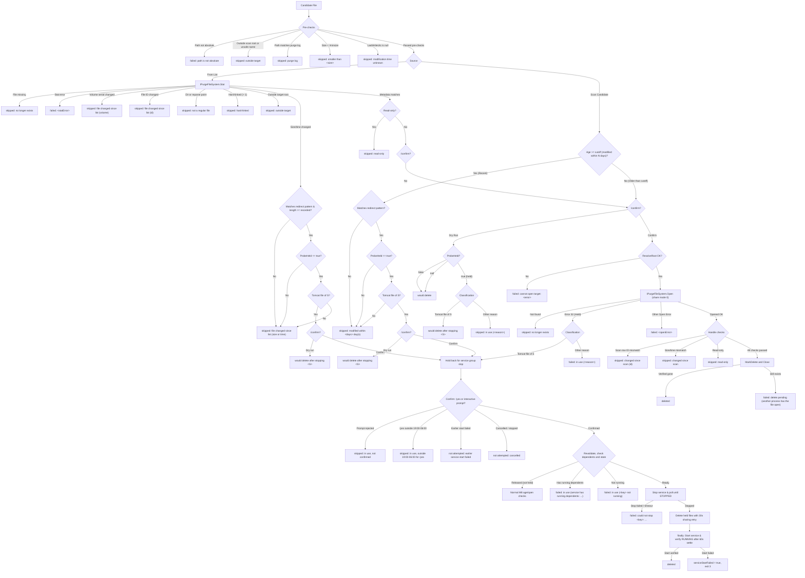

# dirused Purge Reference

`dirused /purge` safely removes large, old files identified during directory scans or loaded from a previously reviewed delete list.

This document describes the complete `/purge` decision path, dry run vs confirm modes, held-file detection, Tomcat service stop-delete-start automation, exit codes, and file formats.

---

## Decision Flow Diagram

The following Mermaid diagram traces the per-file evaluation pipeline across both scan targets and `/fromlist` runs:



---

## Operating Modes

### 1. Dry Run (Default, without `/confirm`)

- Does **not** request `DELETE` access on any file.
- Inspects candidates discovered by `/largest` or listed via `/fromlist`.
- Probes eligible files using `ProbeHeld` (share mode 0 read-data probe) to check if another process holds an open handle.
- If held by a running procrun Tomcat service, outputs `would delete after stopping <service>` and includes the bytes in the would-delete tally.
- If held by another process or unrecognized service, outputs `skipped: in use (<reason>)`.
- If probe returns null (unavailable), keeps `would delete` and prints a stderr notice:
  `in-use check failed for N file(s): <first error>`.

### 2. Confirm (`/confirm`)

- Opens each eligible candidate with `DELETE | FILE_READ_ATTRIBUTES` and share mode 0.
- If a candidate file is not held by a service, verifies volume serial, NTFS file ID, size, and timestamps before deletion, deletes the file, and logs the deletion to `C:\temp\dirused-purge.log`.
- When an `IServiceControl` is available and a file is held by a recognized Tomcat service (either via error 32 or recent-file probe), it is held back rather than immediately failed.
- Held-back rows are grouped by `(host, service key)` and processed in first-seen order:
  1. **Prompt or Window**:
     - Without `/yes`: prompts the operator interactively on stderr with the full group file list and size. Requires explicit `y` or `yes`.
     - With `/yes`: proceeds without interactive prompt if local machine time is between 19:00 and 06:00 (19:00 inclusive, 06:00 exclusive). Outside this window, rows are skipped.
  2. **Revalidation**: re-probes each file right before stopping the service. If contention was released, it falls back to normal deletion checks (including age gates).
  3. **Service State & Dependents**: ensures the service is RUNNING and has no running dependent services.
  4. **Stop**: stops the service and waits up to 120 seconds for `STOPPED`.
  5. **Delete**: opens each held file (retrying error 32 for up to 30 seconds), verifies file identity, ensures length has not shrunk, verifies redirect log naming and root containment, deletes the file, and logs to the purge log.
  6. **Start**: in a `finally` block whenever the service was owned, starts the service, polls until RUNNING, and verifies it remains RUNNING through a 60-second settle period.

---

## Complete Status Reference

Every status emitted by `Purge.cs`:

| Status Text | Meaning |
|---|---|
| `would delete` | Eligible for deletion in dry run; unheld or probe unavailable. |
| `would delete after stopping <service>` | Held redirect log belonging to running Tomcat service `<service>`; eligible once stopped. |
| `deleted` | Successfully deleted and verified removed. |
| `skipped: outside target` | Path is not strictly contained within the target root, or contains unsafe trailing dots/spaces. |
| `skipped: purge log` | The file is the active purge log itself. |
| `skipped: smaller than <size>` | File size is below `/minsize`. |
| `skipped: modification time unknown` | Last write timestamp could not be determined. |
| `skipped: modified within <days> day(s)` | File was modified too recently (younger than `/purge [days]` cutoff). |
| `skipped: no longer exists` | File was deleted or moved between discovery and processing. |
| `skipped: not a regular file` | Path is a directory or reparse point (junction/symlink). |
| `skipped: hard-linked` | File has a hard-link count > 1. |
| `skipped: read-only` | File has the NTFS Read-Only attribute set. |
| `skipped: changed since scan` | Size or modification timestamp changed since scan. |
| `skipped: changed since scan (id)` | Volume serial or NTFS file ID changed since scan (file replaced). |
| `skipped: changed since scan (smaller)` | File size decreased since scan. |
| `skipped: changed since scan (name)` | Final path after stopping is no longer a redirect log or outside `<root>\logs`. |
| `skipped: file changed since list (volume)` | Volume serial does not match saved delete list. |
| `skipped: file changed since list (id)` | NTFS file ID does not match saved delete list. |
| `skipped: file changed since list (smaller)` | File size decreased since saved delete list. |
| `skipped: file changed since list (size or time)` | Size or timestamp changed since saved delete list. |
| `skipped: in use (<reason>)` | Held by another process in dry run. |
| `skipped: in use, not confirmed` | Operator rejected interactive stop prompt or input was redirected without `/yes`. |
| `skipped: in use, outside 19:00-06:00 for /yes` | `/yes` switch used outside the allowed off-hours window (19:00–06:00). |
| `failed: in use (service has running dependents: <names>)` | Cannot stop service because dependent services are active. |
| `failed: in use (<key> not running)` | Service was not in RUNNING state prior to stop attempt. |
| `failed: in use (<reason>)` | Held by another process or non-Tomcat application during `/confirm`. |
| `failed: could not stop <key>: <error>` | SCM open, dependent query, or ControlService call failed. |
| `failed: could not stop <key>: timed out` | Service did not reach STOPPED within 120 seconds. |
| `failed: in use after stopping <key>` | File still locked with sharing violation 30 seconds after service stopped. |
| `failed: path is not absolute` | File path is relative or invalid format. |
| `failed: cannot open target: <error>` | Target root folder could not be opened or resolved. |
| `failed: log write failed` | Purge log could not be written; execution halts to prevent unlogged deletes. |
| `failed: delete pending (another process has the file open)` | File marked for deletion but handle remains open elsewhere. |
| `failed: <error>` | Win32 or I/O error during open or stat. |
| `not attempted: earlier service start failed` | Group skipped because a prior service failed to restart. |
| `not attempted: cancelled` | Operation aborted by user cancellation. |
| `not attempted: log write failed` | Processing halted after log failure. |
| `not attempted: <reason>` | File skipped due to previous fatal stop reason. |

### Classification Reasons for In-Use Files

When a file is held (`ErrorCode == 32`), `<reason>` is determined in this exact order:

1. `no service found` - Path cannot be mapped to a host and local path (e.g. non-admin share, non-fixed drive), or multiple services match.
2. `heap dump, holder unknown` - Case-insensitive filename matches `*.hprof`.
3. `could not list services on <host>: <error>` - Service Control Manager (SCM) could not be opened or enumerated on host.
4. `not a Tomcat log` - Located under a candidate service install root, but filename or parent directory is not a Tomcat redirect log.
5. `id mismatch` - Share-all attribute check (`fs.Stat`) returned a volume serial or file ID different from the scan record.

---

## D1 Age Exemption

Under Decision D1:
- A held Tomcat redirect log matching `<ProcrunName>-stdout.*.log` or `<ProcrunName>-stderr.*.log` inside `<InstallRoot>\logs` of a running Tomcat procrun service is **exempt** from the age rule.
- Active Tomcat processes continuously hold redirect logs open, which leaves directory timestamp metadata stale.
- `/minsize` and size thresholds still apply.
- In dry runs, exempt held logs report `would delete after stopping <service>`.
- In confirm runs with service control, they are queued for group stop, deletion, and restart.
- Files that are not held or not Tomcat redirect logs (e.g. `catalina.*.log`) retain their age skip status.

---

## Summary Lines and Output Format

### In-Use Probe Warning (stderr)

When probe is unavailable on dry runs:
```
in-use check failed for N file(s): <first error>
```

### Held Files Summary (stdout)

Printed after the report when held files are detected:

With a recognized Tomcat service:
```
held files: N (Tomcat: <service> on <host>, root <root>: K file(s), <size>; other: M)
```

Without a Tomcat service:
```
held files: N (other: N)
```

---

## Exit Codes

| Code | Meaning |
|---|---|
| `0` | Success. All targets scanned or all candidates deleted/skipped without error. |
| `1` | Usage error, invalid path, or cannot write purge log / report. |
| `3` | Failure: bad list lines, open errors, files in use during `/confirm`, or service start failed (`ServiceStartFailed`). Service start failure takes precedence over exit code 4. |
| `4` | Critical disk fullness threshold exceeded (`/crit`, exit 3 takes precedence if a service start failed). |

---

## Delete List Format (`/savelist` and `/fromlist`)

Delete lists are UTF-8 encoded text files with CRLF line endings:

```tsv
# dirused delete list v3
# purge days=1 minsize=1GB
# tool version=0.0.26
# created=2026-11-20 08:08:16.0126039 -08:00
# args=\\server\d$\logs /largest *.log /purge /savelist list.txt
# target	volumeSerial	fileId	bytes	size	lastWrite	path
\\server\d$\logs	12345678	0000000012345678	104857600	100M	2026-11-10 04:00:00.0000000 -08:00	\\server\d$\logs\app.log
```

Lines starting with `#` are headers or comments. Fields are separated by a single tab (`\t`):
1. `target`: Root target of scan.
2. `volumeSerial`: 8-digit hexadecimal volume serial number.
3. `fileId`: 16-digit hexadecimal 64-bit NTFS file identifier.
4. `bytes`: Logical file size in bytes.
5. `size`: Display-only human-readable file size (e.g. `138G`, `100M`, `512B`). `/fromlist` checks `bytes` against current file state, not this column.
6. `lastWrite`: Modification time converted to the machine's local time zone with explicit offset (`yyyy-MM-dd HH:mm:ss.fffffff zzz`), readable at a glance.
7. `path`: Full path to candidate file.

The purge line writes `minsize` using the largest exact unit (`1GB`, `1536MB`, `100MB`, `4KB`, or `B` if not an exact multiple of 1024).

Rows where `Purge.IsWouldDelete(status)` is true (`would delete` or `would delete after stopping <service>`) and that possess a valid NTFS identity are written by `/savelist`. Legacy v1 and v2 delete lists are also accepted and read by `/fromlist`.

---

## Purge Log Line Format

Every confirmed deletion, failure, or service lifecycle transition appends a tab-delimited line to `C:\temp\dirused-purge.log`:

```tsv
<Timestamp:o>	<Username>	<MachineName>	<Path>	<Bytes>	<Status>
```

File deletion example:
```tsv
2026-11-20T20:00:00.0000000Z	SYSTEM	SERVER01	D:\Tomcat\Tomcat\logs\tomcat85-stderr.2026-11-04.log	125624128512	deleted
```

Service lifecycle entries use `<ServiceKey>@<Host>` as the path and 0 bytes:
```tsv
2026-11-20T20:00:00.0000000Z	SYSTEM	SERVER01	tomcat85@SERVER01	0	service-stop
2026-11-20T20:00:15.0000000Z	SYSTEM	SERVER01	tomcat85@SERVER01	0	service-start
2026-11-20T20:01:15.0000000Z	SYSTEM	SERVER01	tomcat85@SERVER01	0	service-started
```

If a service fails to restart, it logs:
```tsv
2026-11-20T20:01:15.0000000Z	SYSTEM	SERVER01	tomcat85@SERVER01	0	service-start-failed: timed out waiting for RUNNING
```

---

## Recovery: Tomcat Left Stopped

If dirused encounters a startup timeout, settle failure, or unexpected termination that leaves Tomcat stopped:

### 1. Manual Restart

Start the service using Windows Service Control:

For remote servers:
```cmd
sc \\<host> start tomcat85
```

For the local machine:
```cmd
sc start tomcat85
```

Verify the service reaches `RUNNING` status:
```cmd
sc \\<host> query tomcat85
```

### 2. Next-Run Warning

If a Tomcat service was left stopped or stopped intentionally, any subsequent dirused scan whose target is at, under, or above the service's install root checks whether the service is running. If not, it warns on stderr:

```
warning: <key> on <host> is not running; start it with: sc \\<host> start <key>
```
