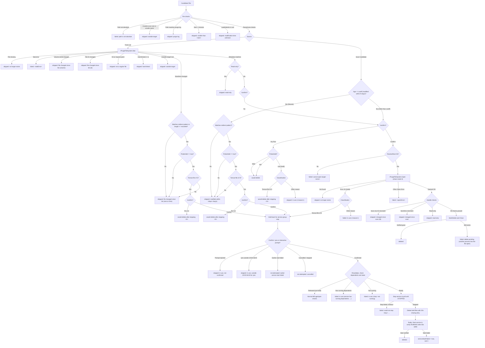

# dirused Purge Reference

## Scheduled purge

dirused supports scheduling a one-time purge of a saved delete list via Windows Task Scheduler.

### Forms

A scheduled purge is configured from a saved delete list using `/fromlist`:

- **Preview:** `dirused /fromlist <file> /purge /schedule <time> [PT|PST|PDT|UTC]`
  Validates the list, checks the run time, displays schedule details, and previews the task without creating it.
- **Confirm with prompt:** `dirused /fromlist <file> /purge /schedule <time> [PT|PST|PDT|UTC] /confirm`
  Displays the preview, asks `Schedule this? [y/N] `, and creates the scheduled task if confirmed with `y` or `yes`.
- **Confirm non-interactive:** `dirused /fromlist <file> /purge /schedule <time> [PT|PST|PDT|UTC] /confirm /yes`
  Creates the scheduled task immediately without an interactive confirmation prompt (`ScheduleCommands.cs:37-41`).

Preview output as Windows prints it:

```text
Scheduled purge preview (nothing is scheduled yet)
  Run:      Mon 2026-11-23 22:30 PST (06:30 UTC Tue), in 1 h 30 min
  Expires:  Tue 2026-11-24 21:00 PST (05:00 UTC Wed)
  Host:     us03p02ffm01
  List:     C:\Users\op\m10b.txt
            12 file(s), 176.2 GB in the list
            sha256 0123456789ab
  Held:     not checked now; files held open at run time are skipped
  Task:     \dirused\S-1-5-21-1-2-3-1104\purge-20261123-2230-a1b2
  Plan dir: C:\Users\op\AppData\Local\dirused\plans\20261123-2230-a1b2
  Program:  C:\Users\op\AppData\Local\dirused\plans\20261123-2230-a1b2\dirused.e
            xe
            (copy of C:\Program Files\dirused\dirused.exe)
It runs only while you are logged on to this machine (disconnected is fine).
Preview only. Add /confirm to schedule it.
```

Time rules:
- Run time must be at least 2 minutes and no more than 23 hours 45 minutes ahead (`Schedule.cs:113-114`).
- Accepted time format is `HH:MM` (`00:00`–`23:59`), optionally followed by a time zone designator: bare time, `PT`, `PST`, `PDT`, or `UTC`.
- A bare time requires the local machine to be set to Pacific time (`Schedule.cs:68`).
- `PT` uses Pacific time and rejects daylight-saving transition gaps (clocks go forward) and ambiguous overlap times (clocks fall back).
- `PST` selects standard time (UTC-08:00), `PDT` selects daylight saving time (UTC-07:00), and `UTC` interprets the time as UTC.

### Where to run it

- Run from a normal window; an elevated (administrator) window is refused (`ScheduleCommands.cs:35`).
- The task runs only while you are logged on (`TaskXml.cs:190` using `InteractiveToken`).
- Disconnected sessions (e.g. RDP window closed without signing out) are fine.
- If you are signed out, the task does not run and the plan state becomes `missed (did not run)`.
- No password is stored.

### Held files

Files held open at run time are skipped, and Tomcat is never stopped or started by a scheduled run (`Purge.cs:495-497`).

### Plan folder and program copy

When scheduled, dirused creates a dedicated plan directory at `%LOCALAPPDATA%\dirused\plans\<id>` holding `plan.txt`, `list.txt`, `dirused.exe`, `task.xml`, and later `claim` and `report.txt` (`ScheduleWindows.cs:172-173`).

The run uses the copied program and list, and refuses if either changed (`refused: program copy changed since it was scheduled` or `refused: list changed since it was scheduled`). A plan expires 24 hours after it is made (`ScheduleCommands.cs:28`).

### `/schedule /list`

`dirused /schedule /list` prints one line per plan with plan id, Pacific time, target host, state, file count and size, and list name:

```text
20261123-2230-a1b2  Mon 2026-11-23 22:30 PST  us03p02ffm01  scheduled  12 file(s) 176.2 GB  m10b.txt
```

Plan states:

| State | Meaning | Action |
|---|---|---|
| `scheduled` | Task is registered with Windows Task Scheduler and waiting for its run time. | None; ensure your user account remains logged on. |
| `running` | Plan is currently executing via its copied program. | Wait for completion; inspect report when finished. |
| `done ( ` | Plan completed execution (e.g. `done (deleted 12 file(s), 176.2 GB freed; 0 skipped; 0 failed, exit 0)`). | Review `%LOCALAPPDATA%\dirused\plans\<id>\report.txt`. |
| `cancelled` | Plan was cancelled before running. | None; reschedule if needed. |
| `expired` | Plan reached its 24-hour expiration time without running. | Reschedule with a fresh delete list. |
| `missed (did not run)` | Scheduled time passed by more than 15 minutes without running (e.g. machine off or user logged off). | Reschedule the run. |
| `task missing` | Plan folder exists, but the Windows Task Scheduler task is missing. | Reschedule or cancel the orphaned plan. |
| `interrupted ( ` | Plan execution began but terminated unexpectedly without writing a report (e.g. `interrupted (started Mon 22:30 PST, no report) — check the list and the report folder`). | Check delete list, purge log, and plan folder to assess state. |
| `permissions changed — not run` | Permissions or ownership on plan folder, parent folder, or copied files changed, or links were detected. | Fix folder permissions and reschedule. |
| `unreadable plan` | `plan.txt` is missing, damaged, or invalid. | Remove the plan folder and recreate if desired. |
| `refused: ` | Execution was refused by `/runplan` (e.g. `refused: not the scheduled time`). | Check the refusal table below for causes and remedies. |

### `/schedule /cancel <id>`

`dirused /schedule /cancel <id>` cancels a pending scheduled purge:
- Writes a `cancel` record to the plan's `claim` file and unregisters the Task Scheduler task (`SchedulePlans.cs:75-95`).
- A plan that has already started running cannot be cancelled (`<id> already started; it cannot be cancelled`).
- If already cancelled, it reports that it is already cancelled.

### `/schedule /trust ["acct"]` and `/schedule /untrust "acct"`

What a trusted folder writer is and when you need one (`PlanTrust.cs`, `TrustCommands.cs`):
To prevent privilege escalation or tampering, dirused validates the ACLs on `dirused.exe`, the plan folder root, and all ancestor directories up to the drive root. Scheduling is refused if any account other than the current user, SYSTEM, Administrators, TrustedInstaller, or CREATOR OWNER has write, append, delete, delete child, change permissions, take ownership, generic write, generic all, or owner rights.

- Broad groups (such as Everyone, Authenticated Users, Users, Guests, and Domain Users) are too wide to trust and are always rejected (`is too wide to trust`).
- If an intermediate folder has legitimate write permissions granted to a specific administrative or service account, trust it by name or SID: `dirused /schedule /trust "DOMAIN\account"`.
- Run `dirused /schedule /trust` with no arguments to list all currently trusted accounts.
- Run `dirused /schedule /untrust "acct"` to remove an account from the trust list.
- Trust records are stored in `%LOCALAPPDATA%\dirused\trust.txt` restricted to the current user.

### `/runplan <id>`

`/runplan <id>` is started by the scheduled task, not by hand, and not listed in `/help`.

Refusals:

| Refusal | Cause | Remediation |
|---|---|---|
| `refused: not a plan id` | Argument does not match the plan ID pattern or plan directory does not exist. | Pass a valid plan ID. |
| `refused: not started from the plan's program copy` | Process was not invoked from the copied `dirused.exe` in the plan directory. | Let Task Scheduler start the copied executable. |
| `refused: plan folder contains a link` | Plan folder, parent folder, or copied file is a reparse point or link. | Remove links and reschedule. |
| `refused: plan folder permissions changed` | Permissions or ownership of plan folder or its files were altered after creation. | Restore ACLs and reschedule. |
| `refused: not a dirused plan` | `plan.txt` is unreadable, invalid, or corrupted. | Reschedule the purge. |
| `refused: not the scheduled time` | Run attempted earlier than 1 minute before or later than 15 minutes after scheduled time. | Execute at scheduled time. |
| `refused: plan already has a report` | `report.txt` already exists in plan folder. | Plan already completed. |
| `refused: plan already started` | Another run instance already created a `claim` file. | Wait for active run to finish. |
| `refused: program copy changed since it was scheduled` | SHA-256 hash of `dirused.exe` does not match hash stored in `plan.txt`. | Do not modify plan files; reschedule. |
| `refused: list changed since it was scheduled` | SHA-256 hash of `list.txt` does not match hash stored in `plan.txt`. | Do not modify plan files; reschedule. |
| `refused: error during run` | Unhandled exception encountered during purge run. | Inspect error details in `report.txt`. |
| `refused:` followed by trust message (`... can be changed by ...`, `... is a link ...`, `cannot read permissions of ...`) | Untrusted account has write permissions on executable, plan root, or ancestors, or a link exists (`PlanRunner.cs:91-98`). | Trust the account via `/schedule /trust` or tighten directory ACLs. |

Non-refusal results:
- `cancelled`: Plan was cancelled before starting (exit 0).
- `expired`: Plan reached 24 hours after creation without running.
- `error: could not claim plan`: Unable to write `claim` file due to filesystem error (exit 3).

Destination of results:
- Written to `report.txt`: results returned through `Report` or `ReportOutcome` (`done`, `expired`, `refused: not a dirused plan`, trust check failures `refused: <trust>`, `refused: program copy changed since it was scheduled`, `refused: list changed since it was scheduled`, and `refused: error during run`).
- Output only to stderr and purge log (`Refuse`): early check failures (`refused: not a plan id`, `refused: not started from the plan's program copy`, `refused: plan folder contains a link`, `refused: plan folder permissions changed`, `refused: not the scheduled time`, `refused: plan already has a report`, `refused: plan already started`, `cancelled`, and `error: could not claim plan`).

### Report

When a run finishes, the report is written to `%LOCALAPPDATA%\dirused\plans\<id>\report.txt`.

Header fields:
- `# id:`: the plan ID.
- `# started:`: start timestamp in ISO format.
- `# finished:`: completion timestamp in ISO format.
- `# outcome:`: final outcome (e.g. `done`, `expired`, or refusal message).
- `# exit:`: process exit code (`0`, `1`, or `3`).
- `# result:`: summary of files deleted and space freed (written only when a run happened; `PlanRunner.cs:190-193`, e.g. `# result: deleted 12 file(s), 176.2 GB freed; 0 skipped; 0 failed`).

The header is followed by the purge results table, held files summary (if applicable), `--- purge log`, and `--- stderr`.

### Scheduling per node

The target host comes from the list's UNC paths. A list naming more than one host is refused (`Schedule.cs:28`: `/schedule: the list covers more than one host (<hosts>); save one list per host and schedule each`).

Save one list per server with `/savelist` and schedule each list separately.

Worked example with two servers (`us03p02ffm01` and `us03p02ffm02`):

```cmd
:: 1. Scan and save delete list for host 1
dirused \\us03p02ffm01\d$\logs /largest *.log /purge /savelist C:\lists\srv1.txt

:: 2. Scan and save delete list for host 2
dirused \\us03p02ffm02\d$\logs /largest *.log /purge /savelist C:\lists\srv2.txt

:: 3. Schedule purge on host 1 for 22:30 PT
dirused /fromlist C:\lists\srv1.txt /purge /schedule 22:30 PT /confirm /yes

:: 4. Schedule purge on host 2 for 23:00 PT
dirused /fromlist C:\lists\srv2.txt /purge /schedule 23:00 PT /confirm /yes
```

`/schedule /list` shows each plan's host:

```text
20261123-2300-b2c3  Mon 2026-11-23 23:00 PST  us03p02ffm02  scheduled   8 file(s) 112.5 GB  srv2.txt
20261123-2230-a1b2  Mon 2026-11-23 22:30 PST  us03p02ffm01  scheduled  12 file(s) 176.2 GB  srv1.txt
```

### Known limits

- A console window may flash at run time (`TaskXml.cs:203`) when Task Scheduler launches the interactive process.
- Old plan folders are not cleaned up yet and remain under `%LOCALAPPDATA%\dirused\plans` until manually deleted.

`dirused /purge` safely removes large, old files identified during directory scans or loaded from a previously reviewed delete list.

This document describes the complete `/purge` decision path, dry run vs confirm modes, held-file detection, Tomcat service stop-delete-start automation, exit codes, and file formats.

---

## Decision Flow Diagram

The following Mermaid diagram traces the per-file evaluation pipeline across both scan targets and `/fromlist` runs:



---

## Operating Modes

### 1. Dry Run (Default, without `/confirm`)

- Does **not** request `DELETE` access on any file.
- Inspects candidates discovered by `/largest` or listed via `/fromlist`.
- Probes eligible files using `ProbeHeld` (share mode 0 read-data probe) to check if another process holds an open handle.
- If held by a running procrun Tomcat service, outputs `would delete after stopping <service>` and includes the bytes in the would-delete tally.
- If held by another process or unrecognized service, outputs `skipped: in use (<reason>)`.
- If probe returns null (unavailable), keeps `would delete` and prints a stderr notice:
  `in-use check failed for N file(s): <first error>`.

### 2. Confirm (`/confirm`)

- Opens each eligible candidate with `DELETE | FILE_READ_ATTRIBUTES` and share mode 0.
- If a candidate file is not held by a service, verifies volume serial, NTFS file ID, size, and timestamps before deletion, deletes the file, and logs the deletion to `C:\temp\dirused-purge.log`.
- When an `IServiceControl` is available and a file is held by a recognized Tomcat service (either via error 32 or recent-file probe), it is held back rather than immediately failed.
- Held-back rows are grouped by `(host, service key)` and processed in first-seen order:
  1. **Prompt or Window**:
     - Without `/yes`: prompts the operator interactively on stderr with the full group file list and size. Requires explicit `y` or `yes`.
     - With `/yes`: proceeds without interactive prompt if local machine time is between 19:00 and 06:00 (19:00 inclusive, 06:00 exclusive). Outside this window, rows are skipped.
  2. **Revalidation**: re-probes each file right before stopping the service. If contention was released, it falls back to normal deletion checks (including age gates).
  3. **Service State & Dependents**: ensures the service is RUNNING and has no running dependent services.
  4. **Stop**: stops the service and waits up to 120 seconds for `STOPPED`.
  5. **Delete**: opens each held file (retrying error 32 for up to 30 seconds), verifies file identity, ensures length has not shrunk, verifies redirect log naming and root containment, deletes the file, and logs to the purge log.
  6. **Start**: in a `finally` block whenever the service was owned, starts the service, polls until RUNNING, and verifies it remains RUNNING through a 60-second settle period.

---

## Complete Status Reference

Every status emitted by `Purge.cs`:

| Status Text | Meaning |
|---|---|
| `would delete` | Eligible for deletion in dry run; unheld or probe unavailable. |
| `would delete after stopping <service>` | Held redirect log belonging to running Tomcat service `<service>`; eligible once stopped. |
| `deleted` | Successfully deleted and verified removed. |
| `skipped: outside target` | Path is not strictly contained within the target root, or contains unsafe trailing dots/spaces. |
| `skipped: purge log` | The file is the active purge log itself. |
| `skipped: smaller than <size>` | File size is below `/minsize`. |
| `skipped: modification time unknown` | Last write timestamp could not be determined. |
| `skipped: modified within <days> day(s)` | File was modified too recently (younger than `/purge [days]` cutoff). |
| `skipped: no longer exists` | File was deleted or moved between discovery and processing. |
| `skipped: not a regular file` | Path is a directory or reparse point (junction/symlink). |
| `skipped: hard-linked` | File has a hard-link count > 1. |
| `skipped: read-only` | File has the NTFS Read-Only attribute set. |
| `skipped: changed since scan` | Size or modification timestamp changed since scan. |
| `skipped: changed since scan (id)` | Volume serial or NTFS file ID changed since scan (file replaced). |
| `skipped: changed since scan (smaller)` | File size decreased since scan. |
| `skipped: changed since scan (name)` | Final path after stopping is no longer a redirect log or outside `<root>\logs`. |
| `skipped: file changed since list (volume)` | Volume serial does not match saved delete list. |
| `skipped: file changed since list (id)` | NTFS file ID does not match saved delete list. |
| `skipped: file changed since list (smaller)` | File size decreased since saved delete list. |
| `skipped: file changed since list (size or time)` | Size or timestamp changed since saved delete list. |
| `skipped: in use (<reason>)` | Held by another process in dry run. |
| `skipped: in use, not confirmed` | Operator rejected interactive stop prompt or input was redirected without `/yes`. |
| `skipped: in use, outside 19:00-06:00 for /yes` | `/yes` switch used outside the allowed off-hours window (19:00–06:00). |
| `failed: in use (service has running dependents: <names>)` | Cannot stop service because dependent services are active. |
| `failed: in use (<key> not running)` | Service was not in RUNNING state prior to stop attempt. |
| `failed: in use (<reason>)` | Held by another process or non-Tomcat application during `/confirm`. |
| `failed: could not stop <key>: <error>` | SCM open, dependent query, or ControlService call failed. |
| `failed: could not stop <key>: timed out` | Service did not reach STOPPED within 120 seconds. |
| `failed: in use after stopping <key>` | File still locked with sharing violation 30 seconds after service stopped. |
| `failed: path is not absolute` | File path is relative or invalid format. |
| `failed: cannot open target: <error>` | Target root folder could not be opened or resolved. |
| `failed: log write failed` | Purge log could not be written; execution halts to prevent unlogged deletes. |
| `failed: delete pending (another process has the file open)` | File marked for deletion but handle remains open elsewhere. |
| `failed: <error>` | Win32 or I/O error during open or stat. |
| `not attempted: earlier service start failed` | Group skipped because a prior service failed to restart. |
| `not attempted: cancelled` | Operation aborted by user cancellation. |
| `not attempted: log write failed` | Processing halted after log failure. |
| `not attempted: <reason>` | File skipped due to previous fatal stop reason. |

### Classification Reasons for In-Use Files

When a file is held (`ErrorCode == 32`), `<reason>` is determined in this exact order:

1. `no service found` - Path cannot be mapped to a host and local path (e.g. non-admin share, non-fixed drive), or multiple services match.
2. `heap dump, holder unknown` - Case-insensitive filename matches `*.hprof`.
3. `could not list services on <host>: <error>` - Service Control Manager (SCM) could not be opened or enumerated on host.
4. `not a Tomcat log` - Located under a candidate service install root, but filename or parent directory is not a Tomcat redirect log.
5. `id mismatch` - Share-all attribute check (`fs.Stat`) returned a volume serial or file ID different from the scan record.

---

## D1 Age Exemption

Under Decision D1:
- A held Tomcat redirect log matching `<ProcrunName>-stdout.*.log` or `<ProcrunName>-stderr.*.log` inside `<InstallRoot>\logs` of a running Tomcat procrun service is **exempt** from the age rule.
- Active Tomcat processes continuously hold redirect logs open, which leaves directory timestamp metadata stale.
- `/minsize` and size thresholds still apply.
- In dry runs, exempt held logs report `would delete after stopping <service>`.
- In confirm runs with service control, they are queued for group stop, deletion, and restart.
- Files that are not held or not Tomcat redirect logs (e.g. `catalina.*.log`) retain their age skip status.

---

## Summary Lines and Output Format

### In-Use Probe Warning (stderr)

When probe is unavailable on dry runs:
```
in-use check failed for N file(s): <first error>
```

### Held Files Summary (stdout)

Printed after the report when held files are detected:

With a recognized Tomcat service:
```
held files: N (Tomcat: <service> on <host>, root <root>: K file(s), <size>; other: M)
```

Without a Tomcat service:
```
held files: N (other: N)
```

---

## Exit Codes

| Code | Meaning |
|---|---|
| `0` | Success. All targets scanned or all candidates deleted/skipped without error. |
| `1` | Usage error, invalid path, or cannot write purge log / report. |
| `3` | Failure: bad list lines, open errors, files in use during `/confirm`, or service start failed (`ServiceStartFailed`). Service start failure takes precedence over exit code 4. |
| `4` | Critical disk fullness threshold exceeded (`/crit`, exit 3 takes precedence if a service start failed). |

---

## Delete List Format (`/savelist` and `/fromlist`)

Delete lists are UTF-8 encoded text files with CRLF line endings:

```tsv
# dirused delete list v3
# purge days=1 minsize=1GB
# tool version=0.0.26
# created=2026-11-20 08:08:16.0126039 -08:00
# args=\\server\d$\logs /largest *.log /purge /savelist list.txt
# target	volumeSerial	fileId	bytes	size	lastWrite	path
\\server\d$\logs	12345678	0000000012345678	104857600	100M	2026-11-10 04:00:00.0000000 -08:00	\\server\d$\logs\app.log
```

Lines starting with `#` are headers or comments. Fields are separated by a single tab (`\t`):
1. `target`: Root target of scan.
2. `volumeSerial`: 8-digit hexadecimal volume serial number.
3. `fileId`: 16-digit hexadecimal 64-bit NTFS file identifier.
4. `bytes`: Logical file size in bytes.
5. `size`: Display-only human-readable file size (e.g. `138G`, `100M`, `512B`). `/fromlist` checks `bytes` against current file state, not this column.
6. `lastWrite`: Modification time converted to the machine's local time zone with explicit offset (`yyyy-MM-dd HH:mm:ss.fffffff zzz`), readable at a glance.
7. `path`: Full path to candidate file.

The purge line writes `minsize` using the largest exact unit (`1GB`, `1536MB`, `100MB`, `4KB`, or `B` if not an exact multiple of 1024).

Rows where `Purge.IsWouldDelete(status)` is true (`would delete` or `would delete after stopping <service>`) and that possess a valid NTFS identity are written by `/savelist`. Legacy v1 and v2 delete lists are also accepted and read by `/fromlist`.

---

## Purge Log Line Format

Every confirmed deletion, failure, or service lifecycle transition appends a tab-delimited line to `C:\temp\dirused-purge.log`:

```tsv
<Timestamp:o>	<Username>	<MachineName>	<Path>	<Bytes>	<Status>
```

File deletion example:
```tsv
2026-11-20T20:00:00.0000000Z	SYSTEM	SERVER01	D:\Tomcat\Tomcat\logs\tomcat85-stderr.2026-11-04.log	125624128512	deleted
```

Service lifecycle entries use `<ServiceKey>@<Host>` as the path and 0 bytes:
```tsv
2026-11-20T20:00:00.0000000Z	SYSTEM	SERVER01	tomcat85@SERVER01	0	service-stop
2026-11-20T20:00:15.0000000Z	SYSTEM	SERVER01	tomcat85@SERVER01	0	service-start
2026-11-20T20:01:15.0000000Z	SYSTEM	SERVER01	tomcat85@SERVER01	0	service-started
```

If a service fails to restart, it logs:
```tsv
2026-11-20T20:01:15.0000000Z	SYSTEM	SERVER01	tomcat85@SERVER01	0	service-start-failed: timed out waiting for RUNNING
```

---

## Recovery: Tomcat Left Stopped

If dirused encounters a startup timeout, settle failure, or unexpected termination that leaves Tomcat stopped:

### 1. Manual Restart

Start the service using Windows Service Control:

For remote servers:
```cmd
sc \\<host> start tomcat85
```

For the local machine:
```cmd
sc start tomcat85
```

Verify the service reaches `RUNNING` status:
```cmd
sc \\<host> query tomcat85
```

### 2. Next-Run Warning

If a Tomcat service was left stopped or stopped intentionally, any subsequent dirused scan whose target is at, under, or above the service's install root checks whether the service is running. If not, it warns on stderr:

```
warning: <key> on <host> is not running; start it with: sc \\<host> start <key>
```
