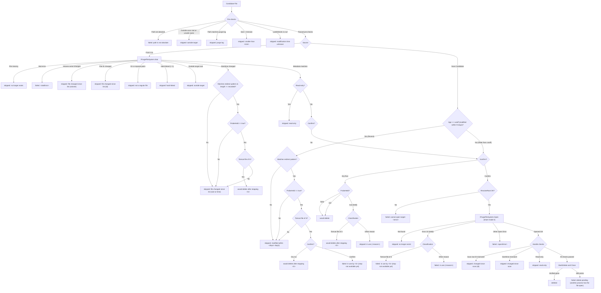

# dirused Purge Reference

`dirused /purge` safely removes large, old files identified during directory scans or loaded from a previously reviewed delete list.

This document describes the complete `/purge` decision path, dry run vs confirm modes, held-file detection, Tomcat service classification, exit codes, and file formats.

---

## Decision Flow Diagram

The following Mermaid diagram traces the per-file evaluation pipeline across both scan targets and `/fromlist` runs:



---

## Operating Modes

### 1. Dry Run (Default, without `/confirm`)

- Does **not** request `DELETE` access on any file.
- Inspects candidates discovered by `/largest` or listed via `/fromlist`.
- Probes eligible files using `ProbeHeld` (share mode 0 read-data probe) to check if another process holds an open handle.
- If held by a running procrun Tomcat service, outputs `would delete after stopping <service>` and includes the bytes in the would-delete tally.
- If held by another process or unrecognized service, outputs `skipped: in use (<reason>)`.
- If probe returns null (unavailable), keeps `would delete` and prints a stderr notice:
  `in-use check failed for N file(s): <first error>`.

### 2. Confirm (`/confirm`)

- Opens each eligible candidate with `DELETE | FILE_READ_ATTRIBUTES` and share mode 0.
- If `Open` fails with Win32 error 32 (`ERROR_SHARING_VIOLATION`), classifies the holder:
  - If held by Tomcat service S: reports `failed: in use by <service> (stop not available yet)`.
  - Otherwise: reports `failed: in use (<reason>)`.
- Verifies volume serial and 64-bit file index (NTFS file ID) before deletion to prevent race conditions from file replacements.
- Applies deletion mark and verifies the file is removed; logs every deletion or failure to the purge log.

---

## Complete Status Reference

Every status emitted by `Purge.cs`:

| Status Text | Meaning |
|---|---|
| `would delete` | Eligible for deletion in dry run; unheld or probe unavailable. |
| `would delete after stopping <service>` | Held redirect log belonging to running Tomcat service `<service>`; eligible once stopped. |
| `deleted` | Successfully deleted and verified removed. |
| `skipped: outside target` | Path is not strictly contained within the target root, or contains unsafe trailing dots/spaces. |
| `skipped: purge log` | The file is the active purge log itself. |
| `skipped: smaller than <size>` | File size is below `/minsize`. |
| `skipped: modification time unknown` | Last write timestamp could not be determined. |
| `skipped: modified within <days> day(s)` | File was modified too recently (younger than `/purge [days]` cutoff). |
| `skipped: no longer exists` | File was deleted or moved between discovery and processing. |
| `skipped: not a regular file` | Path is a directory or reparse point (junction/symlink). |
| `skipped: hard-linked` | File has a hard-link count > 1. |
| `skipped: read-only` | File has the NTFS Read-Only attribute set. |
| `skipped: changed since scan` | Size or modification timestamp changed since scan. |
| `skipped: changed since scan (id)` | Volume serial or NTFS file ID changed since scan (file replaced). |
| `skipped: file changed since list (volume)` | Volume serial does not match saved delete list. |
| `skipped: file changed since list (id)` | NTFS file ID does not match saved delete list. |
| `skipped: file changed since list (size or time)` | Size or timestamp changed since saved delete list. |
| `skipped: in use (<reason>)` | Held by another process in dry run. |
| `failed: in use by <service> (stop not available yet)` | Held by Tomcat service `<service>` during `/confirm`. |
| `failed: in use (<reason>)` | Held by another process during `/confirm`. |
| `failed: path is not absolute` | File path is relative or invalid format. |
| `failed: cannot open target: <error>` | Target root folder could not be opened or resolved. |
| `failed: log write failed` | Purge log could not be written; execution halts to prevent unlogged deletes. |
| `failed: delete pending (another process has the file open)` | File marked for deletion but handle remains open elsewhere. |
| `failed: <error>` | Win32 or I/O error during open or stat. |
| `not attempted: cancelled` | Operation aborted by user cancellation. |
| `not attempted: log write failed` | Processing halted after log failure. |
| `not attempted: <reason>` | File skipped due to previous fatal stop reason. |

### Classification Reasons for In-Use Files

When a file is held (`ErrorCode == 32`), `<reason>` is determined in this exact order:

1. `no service found` - Path cannot be mapped to a host and local path (e.g. non-admin share, non-fixed drive), or multiple services match.
2. `heap dump, holder unknown` - Case-insensitive filename matches `*.hprof`.
3. `could not list services on <host>: <error>` - Service Control Manager (SCM) could not be opened or enumerated on host.
4. `not a Tomcat log` - Located under a candidate service install root, but filename or parent directory is not a Tomcat redirect log.
5. `id mismatch` - Share-all attribute check (`fs.Stat`) returned a volume serial or file ID different from the scan record.

---

## D1 Age Exemption

Under Decision D1:
- A held Tomcat redirect log matching `<ProcrunName>-stdout.*.log` or `<ProcrunName>-stderr.*.log` inside `<InstallRoot>\logs` of a running Tomcat procrun service is **exempt** from the age rule.
- Active Tomcat processes continuously hold redirect logs open, which leaves directory timestamp metadata stale.
- `/minsize` and size thresholds still apply.
- In dry runs, exempt held logs report `would delete after stopping <service>`.
- In confirm runs, they report `failed: in use by <service> (stop not available yet)`.
- Files that are not held or not Tomcat redirect logs (e.g. `catalina.*.log`) retain their age skip status.

---

## Summary Lines and Output Format

### In-Use Probe Warning (stderr)

When probe is unavailable on dry runs:
```
in-use check failed for N file(s): <first error>
```

### Held Files Summary (stdout)

Printed after the report when held files are detected:

With a recognized Tomcat service:
```
held files: N (Tomcat: <service> on <host>, root <root>: K file(s), <size>; other: M)
```

Without a Tomcat service:
```
held files: N (other: N)
```

---

## Exit Codes

| Code | Meaning |
|---|---|
| `0` | Success. All targets scanned or all candidates deleted/skipped without error. |
| `1` | Usage error, invalid path, or cannot write purge log / report. |
| `3` | Failure: bad list lines, open errors, or files in use during `/confirm`. |
| `4` | Critical disk fullness threshold exceeded (`/crit`, takes precedence over 3). |

---

## Delete List Format (`/savelist` and `/fromlist`)

Delete lists are UTF-8 encoded text files with CRLF line endings:

```tsv
# dirused delete list v2
# purge days=1 minsize=1073741824
# tool version=0.0.24
# created=2026-11-20 08:08:16.0126039 -08:00
# args=\\server\d$\logs /largest *.log /purge /savelist list.txt
# target	volumeSerial	fileId	bytes	lastWrite	path
\\server\d$\logs	12345678	0000000012345678	104857600	2026-11-10 04:00:00.0000000 -08:00	\\server\d$\logs\app.log
```

Lines starting with `#` are headers or comments. Fields are separated by a single tab (`\t`):
1. `target`: Root target of scan.
2. `volumeSerial`: 8-digit hexadecimal volume serial number.
3. `fileId`: 16-digit hexadecimal 64-bit NTFS file identifier.
4. `bytes`: Logical file size in bytes.
5. `lastWrite`: Modification time converted to the machine's local time zone with explicit offset (`yyyy-MM-dd HH:mm:ss.fffffff zzz`), readable at a glance. The 7-digit sub-second fraction is retained because `/fromlist` compares times exactly against current file state down to the tick.
6. `path`: Full path to candidate file.

Rows where `Purge.IsWouldDelete(status)` is true (`would delete` or `would delete after stopping <service>`) and that possess a valid NTFS identity are written by `/savelist`. Legacy v1 delete lists (`# dirused delete list v1` with UTC `lastWriteUtc` in ISO 8601 `"O"` format) are also accepted and read by `/fromlist`.

---

## Purge Log Line Format

Every confirmed deletion or failure appends a tab-delimited line to `C:\temp\dirused-purge.log`:

```tsv
<Timestamp:o>	<Username>	<MachineName>	<Path>	<Bytes>	<Status>
```

Example:
```tsv
2026-11-19T17:45:00.0000000Z	SYSTEM	SERVER01	D:\Tomcat\Tomcat\logs\tomcat85-stderr.2026-11-04.log	125624128512	failed: in use by tomcat85 (stop not available yet)
```
